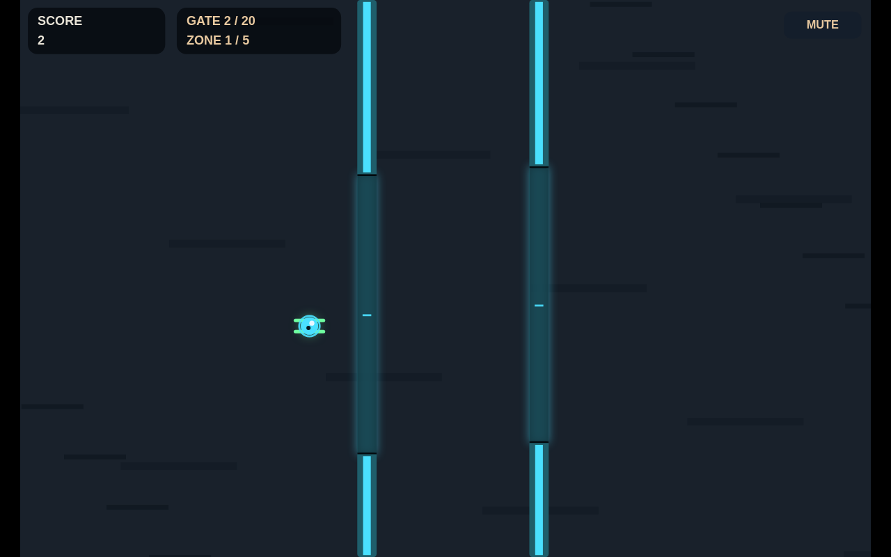
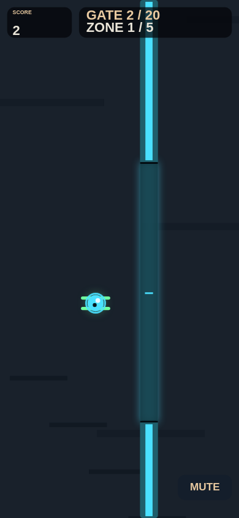

I am Tianyu Liu, a robotics PhD student at MBZUAI. During Season 1 of the K2 Horizon Ascent Challenge (October-November 2026), run by MBZUAI's IEC, I took the quest that asks for exactly one self-contained HTML file that works offline, plus a README and screenshots. This post explains the specific workflow I used, what it produced, and the lessons I took from it.

## The workflow

The pipeline was one script, run.py, run at my direction. Claude Code wrote the pipeline scripts, the offline test harness and the prompts, and executed them. K2 Horizon wrote the design document, all game code, and the README. I chose the concept, played the game, and gave the playtest notes.

1. I asked Claude Code to propose three one-button game directions. I picked "a small delivery drone flying through sliding gates with one button" and said I wanted a simple game without a battery mechanic. K2 named the game AeroThread.
2. K2 wrote a design document.
3. K2 wrote game.html.
4. The script tested every version offline: headless Chrome opened game.html#selftest, where a bot flew a full run through the game's real input functions, landed after gate 20, then crashed on purpose and restarted. The test also failed on console errors and on any attempted network request. Playwright took screenshots at 1280x800 (desktop) and 390x844 (phone).
5. K2 read the test report and fixed the file, or reviewed it when it passed. A failing version went back to K2 with its report.
6. Written notes went to K2 the same way, each labelled with its source: my playtest notes (sent word for word in Chinese with an English translation) and Claude Code's screenshot-review notes (labelled as not a playtest).
7. K2 wrote the README from the final code and a list of facts.

Each fix or feedback round sent K2 the whole current game.html (34 KB for v0, 44 KB for v8), the quest specification, the design document and the test report: 16,034 to 19,340 prompt tokens per round.

## Results

Nine versions were produced. v0 and v5 failed the automated test; the rest passed.

| Version | Test result | What drove the version |
|---|---|---|
| v0 | Fail (1 problem) | Initial write by K2 Horizon |
| v1 | Pass | K2 fix round |
| v2 | Pass | K2 review round |
| v3 | Pass | Claude Code screenshot-review notes (layout, start screen, gate look) |
| v4 | Pass | My first playtest notes |
| v5 | Fail (3 problems) | My second playtest notes |
| v6 | Pass | K2 fix of v5's test failure |
| v7 | Pass | My third playtest notes |
| v8 | Pass | Claude Code screenshot-review note (phone mute button); submitted 2026-10-29 |

| Playtest note | What K2 changed |
|---|---|
| Note 1 (after v3): drone falls too fast, gates move too fast, win should be after 20 gates instead of 50 | v4: gravity 0.55 to 0.42 px/step^2, maximum fall speed 6.2 to 5.4 px/step, maximum gate drift 52 to 26 px, fastest gate opening cycle 1.7 to 2.6 s; win after 20 gates |
| Note 2 (after v4): "make it slower still" | v5: gravity 0.30 px/step^2, maximum fall speed 4.6 px/step, forward speed 1.55-2.35 px/step (was 2.40-3.80), maximum gate drift 14 px, fastest gate cycle 3.0 s. v5 failed; v6 fixed the failure and kept these values |
| Note 3 (after v6): "make the play area bigger from top to bottom, so it has more time to fall" | v7: field enlarged from 640x384 to 880x576; drone start, gate openings, gate drift and landing pad moved or scaled. Falling from the middle to the ground went from about 0.7 s to about 1.0 s. Speeds from v6 kept |

Cost for this workflow: 18 K2 calls, 663,620 tokens, all at high reasoning effort. Output tokens 375,962, of which at least 178,285 were reported as reasoning. The single call that wrote the first game.html produced 49,981 output tokens, 39,521 of them reasoning.

The final version can be played in the browser: [game.html](game.html) (one file, works offline).

## What worked

- Big single tasks: K2 wrote the whole game in one go, self-test bot and demo mode included. Given a test report it fixes the actual cause: v5 failed, v6 fixed it.
- Long inputs are fine: the whole file, spec, design and report went in every round.
- It follows parameter changes reliably: "slower" and "taller" were carried through the physics, the gates and the bot's flight consistently.

## What did not work

- A sweep can miss leftovers: v7 kept the old height of the phone-layout mute button (y=336, tuned for the 384-high field), so on phones it floated in the middle of the right edge. Claude Code's screenshot review caught it; in v8 K2 moved it back to the corner and fixed its label, which had overflowed its box since v6.
- Applying "make it slower still" (v5) broke the automated self-test; a fix round (v6) was needed.
- README provenance: for v8 K2 wrote the README three times. The first lacked the word "goal" (the README check requires it) and called the K2 usage "Claude usage". The second did not name K2 Horizon, said that Claude Code applied the notes (K2 did) and that every version passed (v0 and v5 failed). Claude Code then changed the prompt to ask for exact who-did-what taken only from the fact list; the third README was accurate except one sentence that understated Claude Code's role ("later involvement was screenshot review only"), which Claude Code deleted and disclosed.
- Speed: the first playtest feedback round was still running after about 28 minutes when it was stopped, so that a second request (the 20-gate win) could go into the same round.

## The same patterns in my other workflows

The arXiv research radar (a daily digest of new papers) showed the same extremes. At medium effort with a strict JSON schema, relevance-scoring calls reasoned until the 32,768-token reply cap and returned no answer; in its first runs 19 calls left their JSON answer inside the reasoning field with an empty reply. Fixes were batches of 20 papers at low effort, taking the JSON from the reasoning field (still validated), and switching strict response_format off.

In the same arXiv radar, a fresh K2 session that checks another session's one-line paper notes against the abstracts flagged overstated notes, for example a note claiming "matching lower bounds" that the abstract does not state. In the citation-check workflow, re-checking claims against the full source texts moved one first-pass verdict to "unverifiable". Long inputs were handled fine: the largest prompts were about 77,000 tokens.

Volume adds up: 258 K2 calls across the challenge work so far; on 28 October (Dubai time) about 8.7 million tokens, close to the 10 million tokens per day per key.

## Lessons

1. Wrap every K2 task in an automatic test and send failures back to it to fix (from the game workflow: the harness failed v0 and v5, and the returned reports led to passing v1 and v6).
2. Check with a fresh session, not the one that wrote the content (from the arXiv radar: a fresh K2 session checking another session's one-line paper notes against the abstracts flagged overstated notes).
3. Low effort for classification and scoring; medium or high for writing and fixing code (from the arXiv radar; the game used high reasoning effort for all 18 calls).
4. Give facts as a list and forbid additions; that is what made provenance and numbers accurate (from the game workflow: after Claude Code changed the README prompt to exact who-did-what taken only from the fact list, the third README was accurate except for one sentence that Claude Code deleted and disclosed).
5. Pass people's feedback word for word, labelled with its source, and keep the original (from the game workflow: my playtest notes and Claude Code's screenshot-review notes were sent the same way, with Claude Code's notes labelled as not a playtest).

## How this post was written

Claude Code wrote an outline of observations from the project logs. I approved it ("write it this way") and chose not to revise the post. K2 Horizon wrote the post from that outline and the fact list; a fresh K2 session checked the draft against the fact list. I published it without edits.
